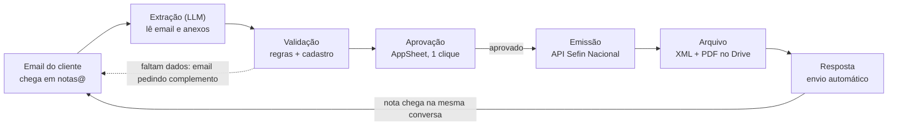
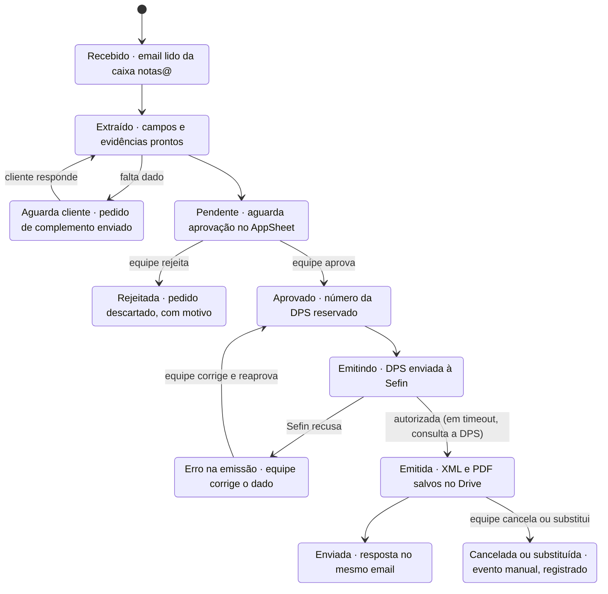
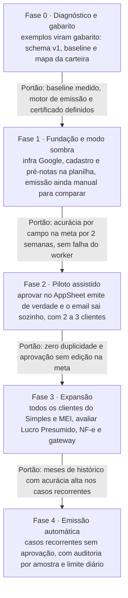

# Plano — Emissão automática de NFS-e a partir de emails

> Cópia do doc online, atualizada em 17/11/2026, onde ficam os comentários: https://claude.ai/artifact/EsoATHBNbz44FLJqhTgGiU. Ao mudar uma decisão, atualize os dois.

## Objetivo e escopo

O sistema lê os pedidos de nota que chegam por email, prepara a NFS-e, emite depois de um clique de aprovação e responde ao cliente com PDF e XML.

- **Escopo do MVP:** NFS-e dos clientes do Simples Nacional e MEI. Desde 1º/nov/2026 eles só emitem pelo Emissor Nacional, então uma única integração cobre o grupo todo.
- **Fora do MVP:** Lucro Presumido e Real em municípios com sistema próprio (como São Paulo), NF-e de produto e emissão sem aprovação humana. Entram nas fases 3 e 4.
- **Premissa:** a aprovação fica antes da emissão, que não tem volta. O envio do email ao cliente é automático desde o início.
- **Quem usa:** os clientes continuam pedindo por email como hoje; a equipe do escritório aprova pelo celular ou pelo computador.

## Fase 0: o que os 5 primeiros pedidos mostraram

Nos 5 pedidos, tudo que muda de uma nota para outra estava no texto do email; o resto saiu do cadastro do cliente e de regras fixas. O desenho se sustenta, com os ajustes abaixo.

| Caso | Pedido | Notas | Do pedido à resposta |
| --- | --- | --- | --- |
| A | Instruções da FIA repassadas pela cliente, com lacuna na descrição | 1 NFS-e | 15h37 (chegou à noite) |
| B | Descrição pronta, consultoria para a Fast Card | 1 NFS-e | 5h47 |
| C | Instruções da Global Music encaminhadas pelo músico, com a conta acrescentada | 2 NFS-e (shows em Curitiba e Belo Horizonte) | 1h11 |
| D | Instruções da produtora encaminhadas, com a conta acrescentada | 1 NFS-e | 58 min |
| E | Mensagem de WhatsApp repassada pela equipe | 1 NF-e de produto | 3h09 |

A mediana entre pedido e resposta foi de 3h09; o pedido da noite esperou o dia seguinte.

**De onde veio cada campo das notas**

| Campo | Origem | Observação |
| --- | --- | --- |
| Tomador (CNPJ/CPF e nome) | Email, 6 de 6 notas | Endereço e CEP na nota vêm da base da Receita; no caso B, o CEP do email era outro |
| Valor | Email, 6 de 6 |  |
| Descrição | Email, 4 de 5 NFS-e | No caso A, modelo com lacuna preenchido com a descrição padrão da cliente |
| Local do serviço | Email, caso C | Define o município do ISS: show (item 12 da LC 116) paga ISS onde acontece |
| Conta no corpo da nota | Email, 4 de 5 | No caso A, veio do cadastro |
| Código de serviço | Cadastro, 5 de 5 | O caso C só sugeriu a atividade |
| Valor aproximado de tributos (Lei 12.741) | Cadastro | Alíquota efetiva do Simples de cada cliente (6,00%, 6,90% e 8,34%); muda todo mês |
| Texto de dispensa de IRRF | Cadastro | Só nas notas do músico |
| Competência | Regra: data de emissão, 5 de 5 | Inclusive no caso B, de serviço de outubro; confirmar com o escritório |

**O que mais apareceu**

- **Escopo confirmado:** as 5 NFS-e são de clientes do Simples em São Paulo, emitidas no Emissor Nacional e todas na série 70000 do emissor web. A automação usa outra série.
- **NF-e por WhatsApp:** 1 dos 5 pedidos é venda de produto e chegou por WhatsApp; a equipe repassou por email. O cliente foi achado pelo assunto, escrito “Bandyeri” em vez de “Bandiery”, então a busca precisa tolerar grafia.
- **Encaminhamentos com lacunas:** em C e D, o tomador deixou banco, agência e conta em branco e o cliente mandou a conta na mensagem de cima. O extrator precisa juntar as duas partes.
- **Remetente diferente do email que aparece no cadastro da nota** (A e D): a lista de remetentes autorizados por cliente é obrigatória.
- **Prazos no próprio pedido** (C e D, inclusive “até 8h de terça”): a fila pode ser ordenada por prazo.
- **Erros manuais que somem com a automação:** o PDF do caso A foi salvo com o nome de outra fundação; “músico” e “musico” em duas notas do mesmo pedido; o rodapé da Lei 12.741 escrito de 4 jeitos.

**Resultado do harness**

- Com extração perfeita, cadastro e regras reproduziram os 49 campos conferidos nas 6 notas. É otimista: o cadastro saiu dessas mesmas notas.
- Uma linha de base só com regex acertou 58 de 65 campos de extração, mas errou o que custa caro: mandaria o ISS das 2 notas de show para São Paulo, perdeu a descrição de A e D e não achou o produto da NF-e. Esse é o trabalho do LLM.
- Nenhum LLM rodou ainda. O harness (gabarito, schema v1, prompt v1) está pronto para o Claude pelo plano e para os modelos locais.

## Decisões tomadas

Quatro decisões estão fechadas; as outras oito são propostas para confirmar na Fase 0. Quando decidir, troque a situação na própria tabela.

| Decisão | Escolha | Motivo | Situação |
| --- | --- | --- | --- |
| Controle humano | Botão “Aprovar” antes da emissão | Nota errada exige cancelamento ou substituição; email errado se corrige com outro email | Decidido |
| Envio ao cliente | Automático desde o início, só depois da nota autorizada | Risco baixo com modelo fixo e destinatário vindo do cadastro | Decidido |
| Arquivos | Google Drive, num drive compartilhado “Notas Fiscais” | Os arquivos ficam do escritório, não de uma pessoa | Decidido |
| Contas e chaves | Contas pessoais do Marsel só até validar o MVP; depois, o desenvolvimento é entregue e a produção usa só chaves e contas do escritório | A operação não fica presa à assinatura de uma pessoa, e o login do plano do Claude é para uso individual, não para um serviço como o worker | Decidido |
| Planilha de controle | Google Sheets em vez de .xlsx | Aceita gravação pela API enquanto a equipe usa; exporta como Excel | Proposto |
| Tela de aprovação | AppSheet sobre a planilha | Hospedado pelo Google, funciona no celular e registra quem aprovou; mais estável que Streamlit | Proposto |
| Estado e anti-duplicidade | SQLite no servidor | A planilha é só a tela; o banco garante uma emissão por pedido | Proposto |
| Infraestrutura | Desenvolvimento no notebook; produção numa VM pequena no Google Cloud do escritório, com conta de serviço anexada e segredos no Secret Manager | Dispensa arquivo de chave JSON, bloqueado por padrão em organizações novas | Proposto |
| Acesso ao Gmail | App OAuth do tipo Interno, autorizado com a caixa notas@ | Sem expiração de 7 dias; troca de senha de alguém da equipe não derruba o sistema | Proposto |
| Papel do LLM | Só extrai os campos do email. No desenvolvimento, modelos locais, o Claude do plano e o Gemini pago com o crédito do Google AI Pro; o provedor de produção sai do eval | Código de serviço, alíquota e retenções vêm do cadastro, nunca do modelo. Nível gratuito só recebe lote anonimizado; o local só vai para produção se empatar nos campos críticos | Proposto |
| Motor de emissão | API direta da Sefin Nacional, atrás de uma interface `Emissor` | Custo zero por nota; gateway ou Simplifique ficam como plano B | Proposto |
| Certificado | Procuração eletrônica com o certificado do escritório; A1 de cada cliente como plano B | Liberada nas APIs desde 1º/nov/2026; falta validar na produção restrita | Proposto |

## Desenvolvimento sem custo

Até validar o MVP, o desenvolvimento não gasta nada: notebook, as contas pessoais do Marsel (o plano Pro da Anthropic e o Google AI Pro), o Workspace do escritório e níveis gratuitos. Depois, o Marsel entrega o desenvolvimento e a produção passa a usar só chaves e contas do escritório.

| Peça | Como fica de graça | Cuidado |
| --- | --- | --- |
| Código | VS Code com Python e o Claude Code do plano Pro, que já cobre a extensão do VS Code; o Google AI Pro dá acesso ao Antigravity, já que o Gemini CLI e o Code Assist deixaram de atender os planos pessoais em 18/jun/2026 | O Claude Code gasta o mesmo limite do chat. Antes de abrir dado de cliente no Antigravity, conferir os termos de dados da conta pessoal |
| Extração com dado real | Ollama no notebook, com os modelos da tabela em Extração e validação | Nada sai do notebook |
| Claude como referência | Plano Pro do Marsel: `claude -p` logado no plano, pelo extrator claude-code do harness. O Pro não tem crédito de API; só Max e Ultra têm | Gasta o mesmo limite do chat, e o Haiku gasta menos. Só para o eval do Marsel no notebook. O worker nunca usa o login do plano, nem no modo sombra: só chave de API, a do escritório depois da entrega. Desligar “Help improve Claude” (Configurações → Privacidade) antes de usar dado real |
| Gemini como referência | Google AI Pro do Marsel: US$ 10/mês de crédito no Google Cloud / GenAI, ativado no Google Developer Program numa conta de faturamento; cada crédito mensal vale por um ano. Gemini pela API no nível pago, pelo extrator compatível com OpenAI | No nível pago, o Google não usa os dados para melhorar produtos. Conferir no faturamento se o crédito abate o uso da API. Até a entrega, serve ao eval e ao worker no modo sombra; depois, entra a chave do escritório |
| Outros modelos para comparar | Níveis gratuitos do Gemini, do Groq e do GitHub Models, pelo extrator compatível com OpenAI | Só lote anonimizado: no Gemini gratuito o Google usa o conteúdo para melhorar produtos, com revisão humana |
| Emails | Arquivos `.eml` baixados do Gmail; depois a API do Gmail lendo um rótulo de teste | Começar pelos arquivos |
| Planilha, Drive, aprovação e avisos | Planilha, pasta, app do AppSheet e webhook do Chat de teste no Workspace; o AppSheet Core já vem nos planos Business | Nunca a planilha real |
| Emissão | Produção restrita da Sefin Nacional | Nota sem valor jurídico |

O custo só aparece na produção, e é pequeno. No Claude Haiku 5.5, a US$ 0,10 por milhão de tokens de entrada e US$ 0,50 de saída, um pedido de uns 5 mil tokens sai por cerca de US$ 0,001: mil pedidos, uns US$ 1. No eval, o Gemini 3.8 Flash pago custa US$ 0,75 por milhão de tokens de entrada e US$ 3,75 de saída até 31/dez/2026, e o dobro a partir de 1º/jan/2027; mesmo assim, uma rodada de 50 pedidos cabe com folga no crédito mensal de US$ 10 do Google AI Pro. O crédito também paga o Gemini 4 Argon como teto de qualidade: US$ 4 por milhão de tokens de entrada e US$ 20 de saída a partir de 1º/dez/2026. A VM cabe na e2-micro do nível gratuito do Google Cloud, que só existe em três regiões dos EUA e exige conta de faturamento.

## Arquitetura

**A nota só é emitida depois do clique em Aprovar.**

Por baixo de tudo, o SQLite guarda o estado de cada nota, o número da DPS e o log.

O cliente escreve como hoje e o sistema prepara a nota. A equipe aprova com um clique, e a resposta volta na mesma conversa com PDF e XML. Se faltar dado, o sistema pede só o que falta.

Em produção, tudo roda num worker Python numa VM pequena no Google Cloud, que lê a caixa e a planilha a cada minuto. No desenvolvimento, o mesmo worker roda no notebook. Um aviso no Google Chat chama a equipe quando há notas aguardando aprovação.

## Estados da nota

**Só a equipe aprova, rejeita, corrige ou cancela; o resto o sistema faz sozinho.**

Em timeout na emissão, o worker consulta a DPS na Sefin antes de repetir, então Emitindo nunca vira nota em dobro. Cada mudança de estado fica no log com data e autor.

## Dados

A planilha é a tela da equipe, o SQLite é a fonte da verdade e o drive compartilhado guarda os documentos fiscais.

| Aba da planilha | Quem usa | Conteúdo |
| --- | --- | --- |
| Notas | Equipe (pelo AppSheet) e worker | ID, recebido em, cliente, tomador, CNPJ/CPF, descrição, valor (R$), competência, alertas, link do email, status, aprovado por, aprovado em, nº da NFS-e, chave de acesso, links do PDF e do XML, enviado em, erro |
| Clientes | Escritório mantém; worker lê | CNPJ, razão social, inscrição municipal, município, regime, opção de destaque IBS/CBS, códigos de serviço permitidos (cTribNac e NBS), alíquota de ISS, retenções padrão, descrição padrão, remetentes autorizados, email de envio, envio automático, procuração e validade |
| Config | Escritório e worker | Envio automático geral, limite de aprovações por ciclo, última execução do worker |

- **Regras da planilha:** o worker atualiza linhas só pelo ID, nunca apaga nem reordena. O AppSheet deixa editar campos apenas enquanto o status é Pendente.
- **SQLite no servidor:** pedidos (email bruto, remetente, resultado de SPF/DKIM, conversa), notas (dados extraídos, dados aprovados, status, nº da DPS, chave), sequência de DPS por cliente e série, e um log de eventos com data e autor. Backup por snapshot diário do disco.
- **Drive compartilhado:** `Notas Fiscais/<Cliente – CNPJ>/<AAAA>/<MM>/`, com arquivos `<nº NFS-e>_<tomador>_<valor>.xml` e `.pdf`. O XML é o documento com valor jurídico; o PDF é o DANFSe gerado pelo sistema.
- **Extraído e aprovado guardados separados:** a diferença entre os dois mede a qualidade do modelo sem trabalho extra.

## Extração e validação

O LLM só transforma o email em campos; tudo que define imposto vem do cadastro, e regras fixas checam cada pré-nota antes da fila.

**O que o LLM devolve (JSON Schema), para cada nota pedida no email:**

- Cliente prestador (pista; a confirmação vem do remetente ou do assunto)
- Tomador: CNPJ ou CPF, nome, endereço e email
- Valor, descrição (pronta, modelo com lacunas ou ausente) e período de referência
- Local do serviço, quando o texto disser (ex.: cidade do show)
- Conta para depósito, vencimento e prazo de envio
- Produtos e quantidades, nos pedidos de NF-e
- Campos faltantes e o trecho do email que sustenta cada campo

Um email pode gerar várias notas. Anexos (planilha, PDF, print) entram como contexto da mesma chamada.

**O que vem do cadastro, nunca do modelo:** código de tributação nacional e NBS, alíquota de ISS, retenções aplicáveis, regime, opção IBS/CBS e série da DPS. Se o cliente tem mais de um código permitido, o modelo escolhe só entre eles, e a escolha vira alerta.

**Checagens, em três níveis:**

- **Volta ao cliente (email automático de modelo):** falta campo obrigatório, como tomador, valor, descrição ou competência.
- **Impede aprovar até corrigir:** CNPJ ou CPF com dígito verificador inválido, valor zero ou negativo, código de serviço fora dos permitidos.
- **Alerta, a equipe decide:** remetente fora da lista ou sem SPF/DKIM/DMARC válido; CNPJ inativo na consulta pública; valor fora da faixa histórica do par cliente × tomador; competência fora da janela do escritório; pedido parecido nos últimos 30 dias; tomador novo; código escolhido pelo modelo.

Qualquer alerta tira a nota da emissão automática da Fase 4.

**Qual modelo extrai:** no desenvolvimento, modelos locais, sem custo e sem dado saindo do notebook, com o Claude do plano e o Gemini pago como referências; o provedor de produção sai do eval. No notebook, que tudo indica ter a RTX 4070 de 8 GB (falta confirmar com nvidia-smi), quatro modelos locais rodam no harness contra o mesmo gabarito:

| Modelo (tag no Ollama) | Na 4070 de notebook (8 GB) | Papel no teste |
| --- | --- | --- |
| Claude Haiku e Sonnet (plano Pro) | Não se aplica | Referência de qualidade; candidato à produção |
| Gemini 3.8 Flash (API paga, crédito do Google AI Pro) | Não se aplica | Segunda referência; candidato à produção |
| Gemini 4 Argon (API paga, crédito do Google AI Pro) | Não se aplica | Teto de qualidade do Google |
| Qwen3.5 9B (`qwen3.5:9b`) | Cabe inteiro | Principal candidato local |
| Gemma 4 12B (`gemma4:12b`) | No limite: parte vai para a RAM | Desafiante local |
| Qwen3 14B (`qwen3:14b`) | Não cabe inteiro; fica mais lento | Desafiante local, já usado por você |
| Qwen 3.6 35B-A3B (`qwen3.6:35b-a3b`) | Quase tudo na RAM; bem mais lento | Teto de qualidade local |

Cada local roda com e sem raciocínio. Se um deles empatar com o Claude nos campos críticos (tomador, valor, descrição e local do serviço), dá para rodar local em produção. Isso exige uma máquina com GPU ligada o tempo todo e um túnel até a VM, com a API de reserva; o notebook não serve para isso, porque hiberna e nem sempre está na rede. Senão, o local fica para desenvolvimento e para clientes que não aceitem dados indo para a API.

## Emissão e envio

A emissão usa a API da Sefin Nacional com trava contra duplicidade; o email ao cliente sai sozinho, mas só depois da nota autorizada.

**Emissão**

- **Fluxo:** o worker monta a DPS em XML, assina com o certificado, compacta em GZip+Base64 e envia por mTLS.
- **Anti-duplicidade:** o número da DPS é reservado no SQLite antes do envio, numa série só da automação. Em timeout, o worker consulta `GET /dps/{id}` antes de qualquer nova tentativa; nunca reenvia às cegas.
- **PDF:** a API oficial do DANFSe foi suspensa em 3/ago/2026. O sistema gera o PDF no layout da NT 008/2026; a biblioteca `pynfse-nacional` já faz isso.
- **Certificado:** desde 1º/nov/2026, as APIs de emissão aceitam atuar em nome do cliente com procuração eletrônica, validada pelo certificado de quem chama. Testar na produção restrita; se falhar, usar o A1 de cada cliente. A procuração precisa cobrir emissão, não só consulta.
- **IBS/CBS:** quem é do Simples e optou pelo destaque preenche os campos a partir de 1º/jan/2027; no regime regular, já valem desde 1º/out/2026. O adaptador nasce com o leiaute novo, porque o piloto deve rodar em 2027.
- **Licença:** `pynfse-nacional` é AGPL-3.0. Serve para uso interno, mas não para um produto vendido sem abrir o código.
- **Nota emitida com erro:** cancelamento ou substituição por evento, sempre feito por alguém da equipe e registrado no log.

**Envio automático**

- Dispara só quando a nota chega a Emitida, com XML autorizado e PDF gerado.
- Responde na mesma conversa, a partir de notas@, com PDF e XML anexos.
- Texto fixo de modelo; nada escrito pelo LLM.
- Destinatário: o remetente autenticado ou o email do cadastro, nunca um endereço citado no corpo.
- Cópia oculta para o escritório; data do envio registrada na planilha.
- Botão de pânico: “envio automático = não” na aba Config, geral ou por cliente. Desligado, o worker cria rascunho em vez de enviar.
- DKIM do domínio ativo no Admin do Workspace, para a resposta com anexo não cair em spam.

## Segurança e LGPD

O sistema trata todo email como possivelmente hostil e o certificado como o ativo mais sensível do projeto.

- **Email hostil (prompt injection):** o LLM só preenche o schema, sem ferramentas nem acesso a nada. Texto do email é dado, nunca instrução.
- **Email falsificado:** remetente fora da lista ou sem SPF/DKIM/DMARC válido vira alerta e nunca entra na emissão automática.
- **Certificado:** fica no Secret Manager, nunca em disco ou no repositório, e só a conta de serviço da VM lê. Com procuração, o certificado do escritório emite por todos os clientes, então é o item mais protegido.
- **Credenciais Google:** VM sem arquivo de chave JSON; a conta de serviço só enxerga o drive compartilhado; o token do Gmail só abre a caixa notas@.
- **Dados pessoais:** CPFs e endereços de tomadores passam pelo LLM. Usar provedor que não treina com os dados e testar no gabarito se um modelo local chega à mesma qualidade. No desenvolvimento, nível gratuito só recebe lote anonimizado. Até a entrega, dado real só passa pelas contas pessoais do Marsel no notebook ou em nível pago; na entrega, as cópias fora das contas do escritório são apagadas.
- **Auditoria:** cada mudança de estado fica no log do SQLite, com data e autor.
- **Retenção:** XML e PDF no Drive pelo prazo legal de guarda; emails brutos no SQLite por prazo a definir com o escritório.

## Fases e entregas

**Cada fase só começa depois que a anterior passa no seu portão.**

O piloto com emissão real deve cair em 2027, por isso o adaptador já nasce com o leiaute de IBS/CBS. As estimativas são de trabalho focado e ficam mais firmes depois da Fase 0.

**Fase 0 · Diagnóstico e gabarito** (3 a 5 dias de trabalho)

- [x] Primeiro lote: 5 pedidos com as 6 notas em PDF
- [ ] Segundo lote: 30 a 50 pedidos, com XML e .eml (ver Próximo passo)
- [x] Gabarito das 6 notas e rótulos de extração dos 5 pedidos
- [x] Schema v1, prompt v1 e harness de avaliação
- [x] Primeira rodada com LLM no harness: Claude (Haiku e Sonnet) pelo plano Pro, via claude -p, Gemini no lote anonimizado (`gemini-3.5-flash-lite` e `gemini-3.1-flash-lite`) e, na RTX 4070, Qwen3.5 9B, Gemma 4 12B e Qwen3 14B
- [x] Ambiente sem custo no notebook: Ollama com os modelos da tabela, “Help improve Claude” desligado, Claude Code no VS Code e o `claude` logado no plano, além do anonimizador `harness/anonimizar.py` (`data_anon/`)
- [ ] Ativar o crédito mensal de US$ 10 do Google AI Pro no Google Developer Program ou direto no AI Studio e criar a chave do Gemini num projeto com faturamento
- [ ] Puxar do Jettax o histórico de notas dos clientes para rascunhar o cadastro
- [ ] Mapear a carteira: regime, município, volume, procuração ou A1
- [ ] Testar emissão por procuração na produção restrita
- [ ] Confirmar as decisões propostas na tabela de decisões

**Fase 1 · Fundação e modo sombra** (cerca de 2 semanas de trabalho, mais 2 de observação)

- [ ] Projeto no Google Cloud, VM, conta de serviço e Secret Manager
- [ ] Drive compartilhado e planilha com as abas Notas, Clientes e Config
- [ ] App OAuth Interno e caixa notas@
- [ ] Cadastro dos clientes do piloto, revisado pelo escritório
- [ ] Worker: Gmail, extração, checagens e linha na planilha
- [ ] Comparação diária entre pré-nota e nota emitida à mão
- [ ] Alerta no Google Chat e célula de última execução

**Entrega ao escritório** (antes do piloto da Fase 2)

- [ ] Escritório cria a conta do provedor escolhido no eval (Claude Console ou Google Cloud com faturamento), com limite de gasto, e gera a chave de produção
- [ ] Chave do escritório no Secret Manager da VM; revogar as chaves pessoais do Marsel
- [ ] Repositório privado transferido para uma conta do escritório no GitHub
- [ ] Projeto do Google Cloud, VM, drive compartilhado, planilha, AppSheet e app OAuth com dono no Workspace do escritório
- [ ] Gabarito e harness entregues ao escritório; dados de clientes apagados do notebook e das contas pessoais do Marsel
- [ ] Passagem a quem vai manter: como rodar, onde ficam os segredos e como trocar o modelo

**Fase 2 · Piloto assistido** (cerca de 2 semanas de trabalho, mais 2 a 4 de piloto)

- [ ] Adaptador Sefin: DPS, assinatura, mTLS, GZip+Base64 e consulta de DPS
- [ ] Reserva do número da DPS e máquina de estados no SQLite
- [ ] DANFSe no layout da NT 008/2026 e upload no Drive
- [ ] Leiaute com IBS/CBS testado na produção restrita
- [ ] App no AppSheet: Pendentes, Aprovar, Rejeitar e edição restrita
- [ ] Envio automático: modelo fixo, resposta na conversa, cópia oculta e botão de pânico
- [ ] Runbook: erro de emissão, cancelamento, substituição e token revogado
- [ ] Piloto com 2 a 3 clientes

**Fase 3 · Expansão** (contínua)

- [ ] Incluir os demais clientes do Simples e MEI
- [ ] Decidir a rota para Lucro Presumido e Real em município com sistema próprio
- [ ] Avaliar a demanda de NF-e
- [ ] Painel com as métricas

**Fase 4 · Emissão automática** (depois de alguns meses de histórico)

- [ ] Definir quem é elegível: tomador e serviço recorrentes, valor na faixa, remetente autenticado e nenhum alerta
- [ ] Calibrar o limiar de confiança no gabarito e no histórico
- [ ] Auditoria por amostra e limite diário de valor
- [ ] Ligar por cliente, com botão de pânico

## Métricas

A decisão de automatizar mais depende de sete números medidos desde o modo sombra. As metas saem do baseline da Fase 0, exceto duplicidade, que é zero sempre.

| Métrica | Como medir | Para que serve |
| --- | --- | --- |
| Acurácia por campo | Pré-nota × nota emitida: valor, CNPJ/CPF, competência, descrição, código | Portão das fases 1 e 4 |
| Aprovação sem edição | % de pré-notas aprovadas sem mudar nenhum campo | Qualidade em produção |
| Tempo até a nota | Mediana entre a chegada do email e o envio da nota | Ganho operacional |
| Duplicidades | Notas emitidas em dobro | Meta zero; um caso pausa o sistema |
| Correções pós-emissão | Cancelamentos e substituições causados pelo sistema | Meta zero; cada caso vira análise |
| Pedidos incompletos | % de emails que geram pedido de complemento | Onde padronizar com os clientes |
| Custo por nota | LLM + infraestrutura ÷ notas emitidas | Acompanhamento |

## Riscos

Os riscos mais caros são nota emitida em dobro e nota com dado errado; os dois têm trava em mais de uma camada.

| Risco | Efeito | Mitigação |
| --- | --- | --- |
| Nota emitida em dobro | Cancelamento e retrabalho com o cliente | Número da DPS reservado antes do envio; consulta da DPS em timeout; estados no SQLite |
| Nota com dado errado | Cancelamento ou substituição | Aprovação humana, checagens e alertas antes da fila |
| Procuração não funcionar na API | Escritório precisa do A1 de cada cliente | Testar na produção restrita na Fase 0; plano B com A1 |
| Leiaute IBS/CBS de 2027 | Nota fora de conformidade | Adaptador isolado, testado antes de jan/2027; gateway como plano B |
| Token do Gmail revogado | Pedidos param de entrar | Caixa dedicada; alerta no Google Chat quando a leitura falha |
| Planilha editada sem querer | Aprovação errada ou dado perdido | SQLite como fonte da verdade; edição restrita no AppSheet; limite de aprovações por ciclo |
| Cliente em município com sistema próprio | API nacional não atende | Fora do MVP; gateway ou Simplifique na Fase 3 |
| Só uma pessoa conhece o sistema | Parada sem suporte | Runbook, alertas, stack simples e este documento |
| Vazamento do certificado | Emissão fraudulenta em nome dos clientes | Controles da seção Segurança e LGPD |

## Pendências

Treze perguntas estão em aberto; as quatro primeiras definem o tamanho do MVP e três vieram dos exemplos.

- [ ] Quantos clientes pedem nota por email, com regime e município de cada um (escritório)
- [ ] Volume de notas por mês e picos (escritório)
- [ ] Os clientes já deram procuração eletrônica para NFS-e, ou o escritório tem os A1? (escritório)
- [ ] Quantos pedidos de NF-e de produto e quantos por WhatsApp chegam por mês? A amostra teve 1 de 5 (escritório)
- [ ] Criar notas@ e avisar os clientes? Hoje os pedidos vão para 1 a 3 pessoas da equipe (escritório)
- [ ] Quem aprova e em que horário? Na amostra, o Danilo emitiu as NFS-e e a Bianca a NF-e (escritório)
- [ ] A competência é sempre a data de emissão, mesmo com serviço do mês anterior? (escritório)
- [ ] Texto único para o rodapé da Lei 12.741 e da dispensa de IRRF (escritório)
- [ ] De onde sai a alíquota efetiva do Simples de cada cliente no mês (escritório)
- [ ] Quais clientes do Simples optaram pelo destaque de IBS/CBS em setembro (escritório)
- [ ] A nota vai só para quem pediu ou também para o tomador? Na amostra, só para quem pediu (escritório)
- [ ] Quem é admin do Workspace, se já existe conta de faturamento no Google Cloud e quem fica dono das contas do Google Cloud, do provedor do LLM e do GitHub na entrega (escritório)
- [ ] Provedor do LLM: API ou modelo local. O local só vai para produção se empatar nos campos críticos e houver máquina ligada o tempo todo (Marsel, depois da primeira rodada)
- [x] Plano da Anthropic: Pro, sem crédito de API; o Claude entra no eval pelo claude -p (Marsel)

## Próximo passo

O próximo lote são 30 a 50 pedidos com as notas que saíram deles, agora com o XML de cada nota e o .eml de cada pedido.

- **Formato:** .eml do pedido (no Gmail pelo computador, menu de três pontos, opção de baixar a mensagem) e XML da nota (baixado no Emissor Nacional). O XML dispensa a leitura do PDF; o .eml mantém SPF/DKIM e anexos.
- **Nome dos arquivos:** `pedido_07.eml` e `nota_07.xml`; várias notas no mesmo pedido viram `nota_07a`, `nota_07b`.
- **Variedade que falta:** retenção de ISS, IRRF ou INSS; tomador pessoa física; tomador ou serviço fora de São Paulo; pedido com anexo (planilha, PDF); pedido corrigido depois; cancelamento ou substituição; mais NF-e e mais pedidos vindos de WhatsApp.
- **Junto, do escritório:** a alíquota efetiva do Simples de cada cliente no mês e a lista de clientes que pedem nota por email.
- **Dados pessoais:** CNPJ e razão social de empresas podem ir como estão. CPF, telefone e endereço de pessoa física: troque por valores fictícios no mesmo formato, iguais no pedido e no XML.

**Depois disso:**

1. Rodar o extrator com Claude e com o Qwen local nos 5 casos atuais e comparar com a linha de base.
2. Incluir o lote novo no harness e rotular os pedidos a partir da saída do LLM, corrigida à mão.
3. Montar o cadastro a partir do histórico, não das notas de teste, e medir de novo a nota composta.
4. Fechar a meta de acurácia por campo que abre a Fase 1.

## Referências

**Fontes consultadas para as datas e regras deste plano**

- [Resolução CGSN 191/2026: Simples no Emissor Nacional desde 1º/nov/2026 (Fenacon)](https://fenacon.org.br/noticias/simples-nacional-nfs-e-nacional-sera-obrigatoria-para-me-e-epp-a-partir-de-1o-de-novembro-de-2026/)
- [Representação e procuração no Emissor e nas APIs (Fenacon, 3/nov/2026)](https://fenacon.org.br/?p=55980)
- [Cronograma dos campos IBS/CBS na NFS-e (Contábeis)](https://www.contabeis.com.br/noticias/79499/nfs-e-compliance)
- [NT 008/2026 v1.02: DANFSe e suspensão da API](https://fenacon.org.br/wp-content/uploads/2026/07/nt-008-se-cgnfse-danfse-20260714-v1-02.pdf)
- [pynfse-nacional no PyPI (AGPL-3.0; versão mais recente 0.9.5, jul/2026)](https://pypi.org/project/pynfse-nacional/0.4.5/)
- [Expiração de autorização OAuth em modo de teste (Google)](https://support.google.com/cloud/answer/15549945?hl=pl)
- [Políticas padrão das organizações no Google Cloud](https://docs.cloud.google.com/organization-policy/manage-baseline-constraints)

**Documentação de apoio para a implementação**

- [Manual da API para contribuintes, Sefin Nacional (gov.br)](https://www.gov.br/nfse/pt-br/biblioteca/documentacao-tecnica/documentacao-atual/manual-contribuintes-emissor-publico-api-sistema-nacional-nfs-e-v1-2-out2025.pdf/@@download/file)
- [Manual das APIs do ADN, com a consulta de DPS (gov.br)](https://www.gov.br/nfse/pt-br/biblioteca/documentacao-tecnica/documentacao-atual/manual-municipios-apis-adn-sistema-nacional-nfs-e-v1-2-out21025.pdf)
- [AppSheet Core incluído no Workspace](https://workspaceupdates.googleblog.com/2023/07/appsheet-core-licenses-included-by-default-for-more-google-workspace-editions.html)
- [Drives compartilhados no Business Starter](https://workspaceupdates.googleblog.com/2024/08/shared-drive-access-business-starter.html)
- [Conta de serviço sem cota no Drive](https://knowledge.workspace.google.com/admin/drive/storage-and-upload-limits-for-google-workspace?rd=1)
- [Revogação de tokens OAuth na troca de senha](https://support.google.com/a/answer/6328616)
- [Simplifique, da Contmatic](https://simplifique.contmatic.com.br/blogs/por-que-simplifique-e-o-melhor-emissor-para-voce)

**Desenvolvimento sem custo** (consultados em 17/nov/2026)

- [Claude Code: legal e conformidade, assinatura × chave de API](https://code.claude.com/docs/en/legal-and-compliance)
- [Claude Code em modo não interativo: `claude -p` e `--json-schema`](https://code.claude.com/docs/en/headless)
- [Créditos mensais de API dos planos Max, Ultra e Team](https://support.claude.com/en/articles/17154008-monthly-api-credits-for-max-and-team-plans)
- [Preços da API da Anthropic](https://platform.claude.com/docs/en/about-claude/pricing)
- [Termos da API do Gemini para uso gratuito](https://aistudio.google.com/docs/terms-preview)
- [AppSheet Core incluído nos planos Business do Workspace](https://workspaceupdates.googleblog.com/2023/07/appsheet-core-licenses-included-by-default-for-more-google-workspace-editions.html)
- [Nível gratuito do Google Cloud](https://docs.cloud.google.com/free/docs/free-cloud-features)
- [Gemini Code Assist e Gemini CLI: fim do atendimento aos planos pessoais em 18/jun/2026](https://developers.google.cn/gemini-code-assist/resources/faqs?hl=en)
- [Preços da API do Gemini, nível gratuito × pago](https://aistudio.google.com/docs/pricing)
- [Créditos do Google Developer Program nos planos Google AI: valores, conta de faturamento e validade](https://developers.google.cn/profile/help/benefits?hl=en)
